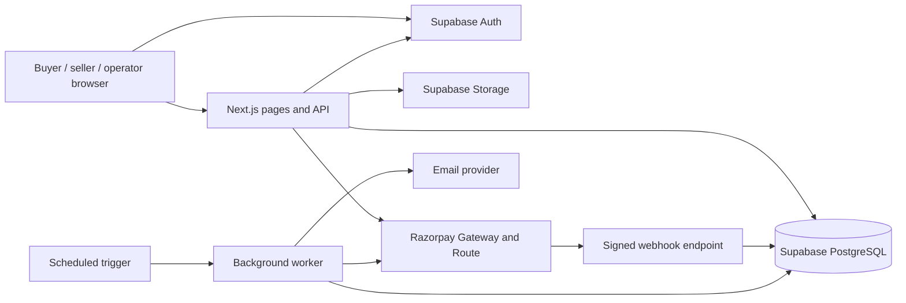
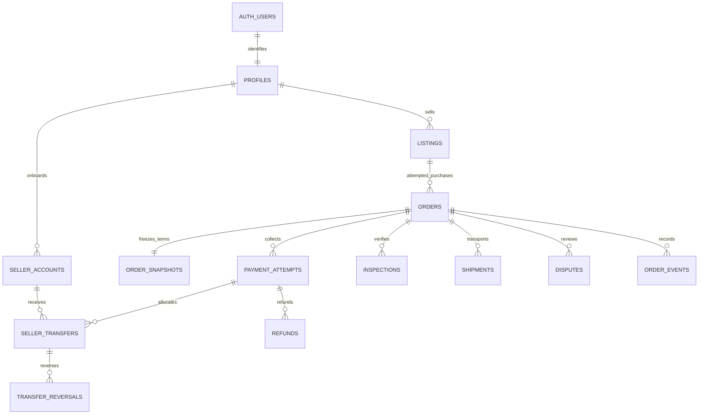

# TrueDeal: Supabase and payment architecture

Date: 2026-11-18. Status: design with a first implementation in the repository.
Supabase Auth, persistent marketplace APIs, SQL migrations, Storage, gated
Razorpay integration and a payment worker endpoint are implemented. Hosted
schema application and end-to-end provider verification remain pending access.
Payments remain disabled as requested. See [the activation runbook](supabase/README.md)
for the implemented scope, manual onboarding/reconciliation boundaries and launch work.

## Decisions and assumptions

- Use the existing Next.js app and Route Handlers as a modular monolith.
- Use Supabase PostgreSQL, Auth and Storage. Start with supabase-js and SQL migrations/RPCs; an additional ORM is unnecessary for this design.
- Use email/password authentication through Supabase Auth, which issues and refreshes JWTs. Do not maintain a separate password database or issue a second application JWT.
- Assume India, INR, individual sellers, one unique item per listing and the existing 48-hour buyer inspection window. These are launch assumptions, not limits on the broader product vision in README.md.
- Razorpay Gateway plus Route is a candidate payment solution, subject to eligibility and written acceptance of the funds flow. It is not yet a confirmed escrow partnership.
- Keep seed/demo data separate from real transactions. Never migrate mock `paid`, `refunded` or `completed` records as real financial events.

## Existing app and required changes

The inspected code already supports seller verification, listing approval, ship-to-hub and onsite inspection, pre-inspected hub stock, delivery, buyer acceptance and disputes.

| Current location | Current behavior | Required production behavior |
| --- | --- | --- |
| `lib/store.ts` | In-memory arrays and synchronous mutations | Persistent repositories and atomic database functions |
| `lib/session.ts`, `app/api/auth/*` | Email lookup, unsigned user ID cookie | Verified Supabase identity and database-backed permissions |
| `app/api/session` POST | Can switch directly to a demo user, including ops | Remove in production |
| `app/api/reset` | Unauthenticated global reset | Remove in production; isolate demo resets |
| `placeOrder()` | Immediately labels an order paid | Reserve item, create checkout, confirm captured payment |
| `release()`, `refund()` | Immediately claim financial completion | Queue provider operation; confirm actual result separately |
| `dispute()`, release route | No deadline enforcement; buyer can reach release while disputed | Enforce deadlines and explicit resolution permissions |
| `lib/types.ts` | Payment, fulfilment and dispute status combined | Separate state machines and immutable timeline |

The local checkout is the source inspected here. The public GitHub repository URL could not be fetched, so remote branch parity was not verified.

## System boundaries

Keep business modules for identity, marketplace, inspections, orders, payments and disputes. Route Handlers validate inputs and identity; services implement business rules; database functions protect cross-row invariants. Payment provider code owns Razorpay API details, not order pages.

Use ordinary user-scoped Supabase clients for reads. Execute multi-row changes in one PostgreSQL RPC transaction; several sequential supabase-js calls are not one transaction. Financial commands need narrow server-only RPC permissions and a server credential. Such a credential must never be exposed through NEXT_PUBLIC variables. RLS does not protect against a privileged client bypassing it.

## Authentication and authorization

1. Sign up with email/password. Supabase manages credentials and confirmation emails.
2. Confirm email through a server-side confirmation route and then sign in with `signInWithPassword`.
3. The SSR integration stores and refreshes the Supabase session in cookies. `proxy.ts` calls `getClaims()` and preserves cookies and refresh cache headers.
4. Protected handlers independently verify identity. Use `getUser()` plus a current account/role lookup for money-moving and administrative actions; do not authorize using `getSession()` alone.
5. Sign out with Supabase Auth. Add password recovery, allowlisted redirect destinations and auth rate limiting before launch.

Create `profiles.id` as a foreign key to `auth.users.id`. A user may both buy and sell: buyer/seller are relationships to a transaction, not exclusive login roles. Store operator/admin grants in a protected `user_roles` table. Clients cannot grant roles, mark themselves verified, change payout amounts or approve their own inspection.

Use the standard Supabase SSR cookie model. Do not assume it is an HttpOnly-only custom JWT design: the browser client also participates in session management. Enforce HTTPS, prevent XSS, and validate Origin/CSRF on cookie-authenticated mutations. Provider webhooks use provider signatures rather than browser CSRF tokens.

The publishable key supplied by the user is intended for client use. It does not grant administrative access or prove that tables, RLS, Auth email settings or Storage policies have been configured.

## Proposed database schema

Use UUID primary keys, `timestamptz` timestamps and integer paise for all monetary values. Each table includes `created_at`; mutable records also have `updated_at`. Financial and audit records are retained rather than cascade-deleted with user accounts. Generate TypeScript database types after migrations.

| Table | Important columns and relationships |
| --- | --- |
| `auth.users` | Supabase-owned identity; do not duplicate passwords or refresh tokens |
| `profiles` | `id -> auth.users`, name, city, account_status; no private payment/KYC details in public projections |
| `user_roles` | user_id, role (`ops`, `admin`), granted_by; unique user/role |
| `addresses` | user_id, recipient, phone, address lines, city, state, postcode, country |
| `seller_accounts` | user_id, provider, environment, provider_account_id, product_config_id, onboarding_status, payouts_enabled, bank_last4; unique provider/environment/account |
| `seller_verifications` | seller_id, provider_reference, status, reviewed_by, reviewed_at; app review and payment-provider activation are distinct |
| `categories` | slug, label, active; configurable checklist reference |
| `fee_policies` | version, effective_at, commission_bps, min_commission_paise, onsite_fee_paise, inspection_hours, category charge rules |
| `listings` | seller_id, category_id, title, description, condition, price_paise, status, mode (`order`, `hub`), handover_mode, serial, version; flexible specs in JSONB |
| `listing_media` | listing_id, storage_path, sort_order, kind; no arbitrary trusted external upload URL |
| `orders` | public_order_number, listing_id, buyer_id, seller_id, fulfilment_status, financial_decision, reservation_expires_at, delivered_at, inspection_deadline_at, buyer_accepted_at, version |
| `order_snapshots` | order_id unique, product_snapshot JSONB, address_snapshot JSONB, fee_policy_version, price_paise, shipping_paise, inspection_paise, commission_paise, visit_paise, total_paise, seller_due_paise, currency |
| `payment_attempts` | order_id, provider, environment, provider_order_id, provider_payment_id, amount_paise, currency, status, failure_reason, captured_at; one order may have retries |
| `seller_transfers` | order_id, payment_attempt_id, seller_account_id, provider_transfer_id, amount_paise, transfer_status, settlement_status, on_hold, release_requested_at, settled_at |
| `provider_settlements` | provider_settlement_id, seller_account_id, status, amount_paise, fees_paise, tax_paise, provider_reference; settlements may include multiple transfers |
| `settlement_items` | settlement_id, seller_transfer_id, amount_paise; reconcile transfer-to-settlement membership |
| `refunds` | order_id, payment_attempt_id, provider_refund_id, amount_paise, reason, status, requested_by, processed_at |
| `transfer_reversals` | transfer_id, refund_id nullable, provider_reversal_id, amount_paise, status; reversal and customer refund are separate operations |
| `inspections` | listing_id, order_id nullable, inspector_id, tier, grade, serial, seal, result, checklist_snapshot JSONB, notes, report_version; supports pre-sale hub reports |
| `shipments` | order_id, leg (`seller_to_hub`, `hub_to_buyer`, `return`), courier, tracking_number, status, delivered_at, delivery_evidence_path |
| `disputes` | order_id, opened_by, reason, detail, status, resolution, resolved_by, resolved_at; at most one open dispute per order |
| `dispute_evidence` | dispute_id, submitted_by, storage_path, evidence_type |
| `payment_disputes` | payment_attempt_id, provider_dispute_id, status, amount_paise, evidence_due_at; external chargebacks are distinct from buyer product claims |
| `order_events` | order_id, event_type, previous_state, next_state, actor_id, source, provider_reference, metadata; append-only |
| `webhook_events` | provider, environment, event_id, event_type, payload, received_at, processed_at, attempts, last_error; unique provider/environment/event |
| `payment_operations` | order_id, operation_type, idempotency_key, request_hash, state, provider_reference, last_error; unique business operation key |
| `outbox_jobs` | operation_id, job_type, run_after, attempts, lease_until, status, dedupe_key; persistent retries |
| `ledger_accounts`, `ledger_transactions`, `ledger_entries` | Internal reconciliation accounts, unique business event, debit/credit entries in paise; every posted transaction balances |
| `audit_logs` | actor_id, action, entity_type, entity_id, request_id, redacted metadata; operator actions recorded |

Do not store full bank details or PAN in public profiles. Prefer provider-managed onboarding and references; if sensitive data must be retained, define encryption, restricted access and retention first. Raw webhook payloads also require restricted access and a retention policy.

### Constraints and indexes

- Server computes and freezes charges: buyer total = price + shipping + inspection; seller due = price - commission - onsite visit. This preserves the current prototype's rules. Tax, gateway/Route fees and cost allocation require an explicit policy before live use; the retained amount is not all profit.
- Every amount is nonnegative, refunds cannot exceed captured funds, and aggregate transfers cannot exceed available captured funds. Enforce cross-row totals inside locked database functions, not only application validation.
- Buyer cannot equal seller. Seller must own the listing. Only one current reservation/committed sale can claim a listing; enforce a unique active-listing claim and lock the listing on checkout.
- Unique provider IDs are scoped by provider/environment. Application operation keys also bind request hashes, so reusing a key with a different amount fails.
- Index order history by `(buyer_id, created_at)` and `(seller_id, created_at)`; browse by listing status/category/date; due release work by deadline; jobs by status/run_after. Index foreign keys used for joins/RLS.
- Lock the order row for both dispute creation and payout authorization. A unique financial decision prevents refund and release from both winning.

### RLS and database permissions

Enable RLS on exposed tables and grant only required operations. RLS is row access, not a substitute for column restrictions or transition checks.

| Data | Read | Write |
| --- | --- | --- |
| Public listing projection and safe seller display | Everyone for approved listings | Seller edits drafts through validated API; approval fields restricted |
| Profile/address | Owner; limited explicit operator access | Owner can edit allowlisted personal fields only |
| Order and report | Buyer/seller and assigned/authorized ops | Narrow transition RPCs; no general client UPDATE |
| Seller verification/account | Owner sees safe onboarding summary | Server/provider results and authorized review only |
| Payment/refund/transfer summary | Relevant order participant sees a safe projection | Provider webhook/worker only |
| Roles, ledger, webhook payloads, jobs, operations | Server and narrowly authorized admin tooling | Server only; append-only where appropriate |
| Evidence files | Order participants/assigned ops under evidence policy | Scoped uploads; immutable submitted evidence |

Public views must use safe columns and appropriate invoker security. Definer functions require a fixed search_path, fully qualified objects and explicit EXECUTE grants. Authenticated-user functions derive identity from `auth.uid()`; server-only functions accept actors only after trusted server validation. Revoke unintended public function execution.

## Razorpay Route: fit and unresolved eligibility

Razorpay documents Route as payment splitting, linked accounts, transfer reversals and settlement control. That is a technical basis for conditional seller payouts; it does not by itself establish TrueDeal as an approved legal escrow service. [About Route](https://razorpay.com/docs/payments/route)

The published eligibility page lists domestic turnover above INR 40 lakh or export turnover above INR 5 lakh, with use-case review. It still names FY25/FY26: confirm the currently accepted financial years and your account's eligibility directly. Its FAQ describes self-declaration in some cases; do not infer an exemption from the financial threshold. [Route eligibility FAQ](https://razorpay.com/docs/payments/route/faqs)

Obtain confirmation for individual used-goods sellers, required KYC/bank onboarding, total shipping-plus-inspection hold duration, dispute extensions, refund/chargeback handling, pricing and reserves. Do not replace Route with ordinary gateway collection into TrueDeal's bank account and describe that as equivalent escrow.

### Intended integration

1. Onboard each seller as a linked account and verify required product/settlement activation. Disable checkout if the seller cannot receive funds.
2. Atomically reserve a live listing and save an `awaiting_payment` order with immutable charges. Proposed reservation TTL: 15 minutes.
3. Create a Razorpay Order on the server with the buyer total and a seller transfer allocation for seller_due, held from the outset. Store all IDs before returning Checkout options. This avoids a gap in which a captured payment has no intended seller allocation. Order-level transfers and captured-payment transfers are documented alternatives; use one consistent model. [Transfers from Orders](https://razorpay.com/docs/api/payments/route/create-transfers-orders)
4. Open Standard Checkout. Verify its signature server-side using the stored Razorpay order ID, then verify captured amount, INR currency and order linkage. Browser success alone cannot authorize fulfilment. A webhook or server reconciliation can finish the same idempotent transition if the buyer closes the tab. [Checkout integration](https://razorpay.com/docs/payments/payment-gateway/web-integration/standard/integration-steps)
5. Track confirmed capture and confirmed held allocation separately. A failed transfer leaves a paid order in payment review with an operational alert; never claim it is protected/ready to ship merely because Checkout succeeded.
6. Complete handover and inspection, or reuse the immutable report for pre-inspected hub stock. Record shipment and trusted delivery evidence. Set the deadline from confirmed delivery, not checkout time.
7. After buyer acceptance or expiry of 48 hours, authorize release atomically only if inspection passed and no product claim, payment dispute or refund is active. Buyer acceptance cannot resolve an open dispute; an authorized decision is required.
8. Worker removes the settlement hold. Track `release_requested`, `release_authorized` and `settled` distinctly. Hold removal is not confirmation that the bank received funds. [Modify settlement hold](https://razorpay.com/docs/api/payments/route/modify-settlement-hold)
9. Failed inspection, valid pre-handover cancellation or approved return creates a refund workflow. Verify any required return receipt first. Track transfer reversal and customer refund independently; show refunded only after confirmed processing. Keep enough primary-account/refund liquidity for charges and timing differences. [Refund and reverse transfer](https://razorpay.com/docs/api/payments/route/refund-payments-and-reverse-transfer)

Prefer an explicit hold released by a worker, rather than a provider-side date that might release during a dispute. The API describes an unset `on_hold_until` as an indefinite hold; permissible business duration still needs provider confirmation. Settlement timing remains subject to the linked account's schedule. [Settlement scheduling](https://razorpay.com/docs/payments/route/schedule-settlement/)

## State machines and concurrency

Keep these dimensions independent:

- Fulfilment: awaiting_payment -> awaiting_handover -> in_transit_to_hub -> at_hub -> verified -> shipped -> delivered -> closed; separate cancellation/inspection_failed/return paths.
- Payment attempt: created -> authorized -> captured, or failed; refunds in separate rows.
- Seller funds: allocation_pending -> held -> release_pending -> release_authorized -> settled; reversal and failure paths tracked separately.
- Dispute: open -> reviewing -> return_required/resolved_refund/resolved_release. External chargebacks use their own records and also block release.

Never call the provider while holding a long database transaction. Commit a uniquely identified payment operation and outbox job first, then perform the external call, then persist its result. The network and database do not share an atomic transaction.

Provider timeouts are unknown outcomes. Reconcile by stored IDs and provider queries before retrying money movement; do not assume every Razorpay endpoint supports idempotency. An order-level transfer plan helps avoid duplicate transfer creation but does not remove the need to reconcile ambiguous order creation.

The scheduled release transaction checks deadline using database time, current delivery/inspection/dispute state and the unique financial decision. The dispute transaction takes the same lock. Define the boundary: a dispute accepted before release authorization blocks it; once authorized, later claims require a separate recovery/manual process and cannot be guaranteed to recall settlement. A short operational grace period may be added as product policy.

Reservation expiry checks provider payment state before freeing stock. If capture arrives after a reservation was released, fulfil only if the item is still atomically reclaimable; otherwise refund the late payment. Never sell one item twice or discard a paid notification because a local timer expired.

## Webhooks, jobs and reconciliation

`POST /api/webhooks/razorpay` is public but signature-authenticated, excluded from browser session refreshing. Verify HMAC over raw request bytes with the webhook secret. Persist/deduplicate the event durably before returning 2xx; return a retryable failure if persistence fails. Process asynchronously and reconcile entity state when events conflict. Razorpay explicitly documents duplicate and out-of-order delivery. [Webhook verification](https://razorpay.com/docs/webhooks/validate-test)

Use database-backed outbox jobs and a scheduled authenticated worker/Edge Function. Do not use `setTimeout` in Next.js for a 48-hour release. Jobs cover expiry, release, refund/reversal, provider status reconciliation and notifications. Use leases, bounded retries and manual review for unknown/failing financial operations. Never re-open release eligibility automatically because a retry failed.

Record every confirmed financial event once in a balanced internal ledger. This is reconciliation accounting, not a user wallet or a claim that TrueDeal holds customer deposits. Reconcile captured totals, held allocations, settled sums, fees, refunds and reversals against provider records. Alert on mismatches, stuck operations and settlement failures.

## API contract

Retain existing URLs where practical, but replace implementations and response DTOs.

| Endpoint | Responsibility |
| --- | --- |
| `POST /api/auth/signup`, `/signin` | Supabase email/password flows |
| `GET /api/session`, `DELETE /api/session` | Verified identity/profile and sign-out; delete demo-switch POST |
| `/auth/confirm`, `/auth/reset-password` | Email confirmation and recovery with validated redirects |
| `POST /api/sellers/onboarding` | Start/resume provider linked-account onboarding |
| `POST /api/orders` | Validated quote snapshot and atomic reservation |
| `POST /api/orders/:id/checkout` | Create/reuse provider order; require idempotency key |
| `POST /api/payments/verify` | Signature + captured-state verification; same handler logic as reconciliation |
| `POST /api/orders/:id/release` | Buyer acceptance or authorized ops resolution; queues release |
| `POST /api/orders/:id/dispute` | Atomically open eligible claim and block release |
| `POST /api/orders/:id/refund` | Authorized decision, return preconditions and refund operation |
| `POST /api/webhooks/razorpay` | Durable signed payment events |
| Worker invocation | Authenticated scheduled processing; never a public money-moving endpoint |

Validate request bodies, enforce ownership and return safe DTOs rather than whole database rows. Server computes all prices and fee splits. No browser endpoint accepts arbitrary provider account IDs, transfer amounts or privileged roles.

## Storage and operations

Use separate Supabase Storage buckets/policies for listing photos and private inspection, shipping and dispute evidence. Use signed URLs for private evidence, ownership-scoped paths, upload limits and content validation. Store file paths and metadata in PostgreSQL, not file bytes.

Use distinct development/staging and production data and provider keys. Select backup/PITR and restore procedures appropriate to paid transactions; Storage object recovery is a separate concern from database backup. Run migrations through reviewed files, never ad-hoc production dashboard changes. Pin SDK versions through the lockfile.

Before launch configure email delivery/redirects, restricted operator onboarding and MFA, worker secrets, webhook secrets, monitoring, retention rules, database backups and refund liquidity. Display accurate provider relationships: the current partner logo list is prototype copy, not evidence of an agreement.

## Delivery sequence and verification

1. Foundation (this change): SDKs, ignored local settings, browser/server clients, Next.js 16 refresh proxy, and this proposal.
2. Auth + schema: versioned SQL migrations, RLS and grants, generated types, signup/confirmation/password login/recovery, profiles and roles. Replace demo sessions and reset routes before using real data. Leave existing mock data in an isolated demo mode until all dependencies migrate.
3. Marketplace + orders: persistence, inspection/report/media flows, immutable quotes, atomic reservation and explicit state transitions.
4. Payment sandbox: approved seller onboarding, Checkout, signed callbacks/webhooks, held transfer confirmation, refunds, ledger and reconciliation.
5. Release automation: durable worker, dispute/resolution/return rules and failure recovery.
6. Live pilot only after payment-provider eligibility, funds-flow acceptance and end-to-end verification.

Required tests for implementation: user A cannot access user B's addresses/orders/evidence; public cannot access KYC; no self-granted ops role; tampered/expired sessions rejected; expired sessions refresh with cache headers; two concurrent checkouts cannot claim one item; duplicate/out-of-order webhooks post once; bad signatures fail; wrong amount/currency cannot fulfil; crash after provider success reconciles; late capture refunds safely; dispute and release cannot both win; provider timeout cannot cause duplicate payout/refund; settlement and refund status reflect confirmed outcomes; hub-stock and onsite paths both work.

Validation now includes embedded PostgreSQL migration/RLS/state-machine tests,
payment HTTP contract/security tests and application build checks. The supplied
project's new schema endpoint returned 404 and the CLI had no authenticated
session. No hosted migrations, real account creation or Razorpay money movement
were performed during implementation.

Supabase references checked for this proposal: [SSR clients and session refresh](https://supabase.com/docs/guides/auth/server-side/creating-a-client?queryGroups=framework&framework=nextjs) and [Row Level Security](https://supabase.com/docs/guides/database/postgres/row-level-security). Next.js proxy and cookies conventions were checked against the installed `node_modules/next/dist/docs/` guides.
